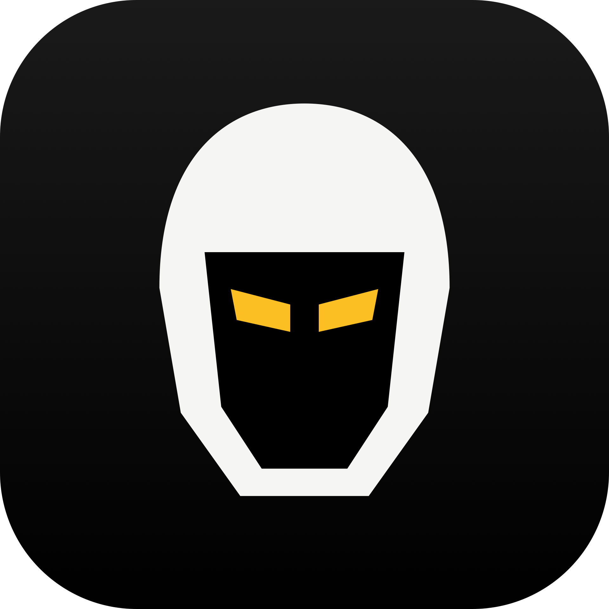

  

## Vigilant

A native macOS menu bar app that keeps your Mac awake. Stay awake indefinitely, for a set duration, until a specific time, or while an app is running, and let it kick in automatically when you plug in power, connect an external display, or open the apps you choose, all while protecting your battery and staying out of your way.

### License

[MIT](https://github.com/glhrmoura/vigilant/blob/main/LICENSE)

Copyright (c) Guilherme Moura
